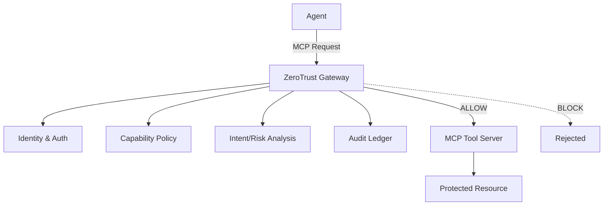

# Architecture

## Technical Stack
- **Frontend**: React + TypeScript + Vite, Tailwind CSS
- **Backend**: Python + FastAPI
- **Gateway**: Python service for interception and enforcement
- **Data**: Local SQLite
- **Policy**: YAML policy definitions

## Architecture Flow

## Security Model
1. **Identity**: Identify agent, session, tool, resource, requested operation.
2. **Capability Policy**: Explicit allowed/denied permissions per agent.
3. **Tool Classification**: Categorize tools (READ, WRITE, EXECUTE, NETWORK).
4. **Context/Intent Inspection**: Evaluate if action is consistent with user intent, policy.
5. **Runtime Enforcement**: ALLOW, BLOCK, REQUIRE_APPROVAL.
6. **Sandbox**: Simulated boundary for prototype.
7. **Audit**: Immutable ledger of all events.
